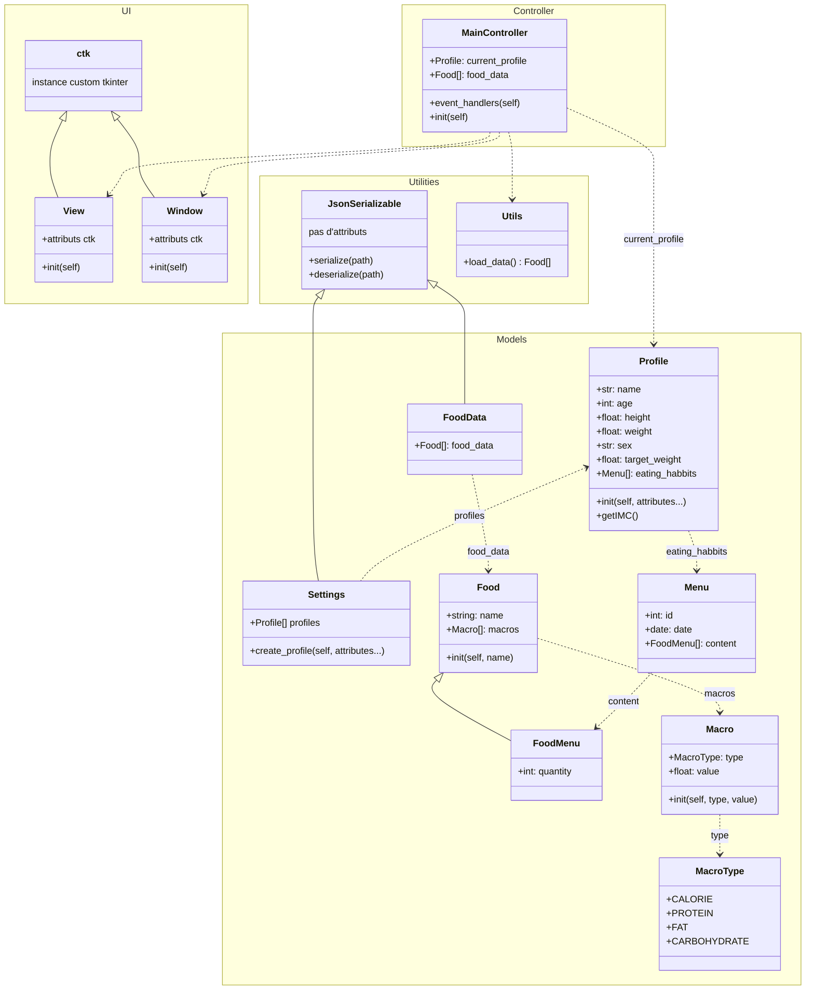

# Architecture

```
NUTRITRACK/
│
├── src/ 
│    │
│    ├── views/                       # Pages de l'interface (CustomTkinter)
│    │   ├── home_page.py
│    │   ├── nutrition_page.py
│    │   └── stats_page.py
│    │
│    ├── models/                    # Algorithmes et logique
│    │   ├── user.py
│    │   ├── profile.py 
│    │   └── nutrition.py   
│    │
│    ├── controllers/                    
│    │   ├── control_home_page.py
│    │   ├── control_nutrition_page.py
│    │   └── control_stats_page.py  
│    │
│    ├── data/        
│    │   ├── json/              
│    │   │   ├── aliments.json
│    │   │   └── profils.json  
│    │   │   
│    │   └── data_loader.py     # accès aux fichiers             
│    │
│    └── assets/                   # Ressources statiques
│        ├── images/
│        └── fonts/
│
├── tests/    
│   │            
│   ├── test_models/
│   │   ├── test_nutrition_calc.py
│   │   └── test_threshold_check.py
│   │
│   ├── test_controllers/
│   │   └── test_recommender.py
│   │
│   └── test_data/
│       └── test_data_loader.py
│
├── venv/                     
├── main.py                   
├── .gitignore                
├── cahier-des-charges.md
├── Architecture.md            # Ce fichier
├── README.md
└── REQUIREMENTS.txt
```


