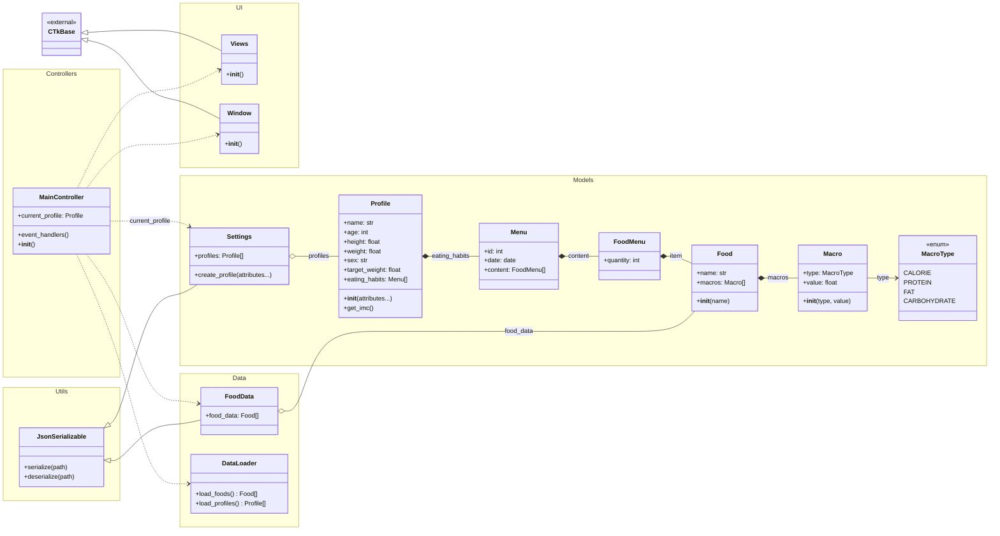

# Architecture

```
NUTRITRACK/
│
├── src/
│   ├── views/                      # UI (CustomTkinter)
│   │   ├── base_view.py
│   │   ├── main_window.py
│   │   ├── home_page.py
│   │   ├── login_page.py
│   │   ├── nutrition_page.py
│   │   └── stats_page.py
│   │
│   ├── controllers/                # Orchestration / evenements
│   │   ├── main_controller.py
│   │   ├── home_controller.py
│   │   ├── login_controller.py
│   │   ├── nutrition_controller.py
│   │   └── stats_controller.py
│   │
│   ├── models/                     # Domaine
│   │   ├── settings.py             # Liste des profils + regles
│   │   ├── profile.py
│   │   ├── menu.py
│   │   ├── food.py
│   │   ├── food_menu.py
│   │   ├── macro.py
│   │   └── macro_type.py
│   │
│   ├── data/                       # Acces aux donnees
│   │   ├── data_loader.py
│   │   ├── food_data.py
│   │   └── json/
│   │       ├── aliments.json
│   │       └── profils.json
│   │
│   ├── utils/
│   │   └── json_serializable.py
│   │
│   └── assets/                     # Ressources statiques
│       ├── images/
│       └── fonts/
│
├── tests/
│   ├── test_models/
│   ├── test_controllers/
│   └── test_data/
│
├── venv/
├── main.py
├── .gitignore
├── cahier-des-charges.md
├── Architecture.md                 # Ce fichier
├── README.md
└── REQUIREMENTS.txt
```


