Yanis Belaid, Marouan El-Hamdeoui, Nolan Mahadali, Léo Peyronnet, Dhia Somai

# Architecture - Projet Nutritrack

## Vue d'ensemble

Le projet Nutritrack est structuré selon une architecture MVC (Model-View-Controller) pour assurer une séparation claire
des responsabilités et faciliter la maintenance. Voici une description détaillée de l'architecture proposée :

```
NUTRITRACK/
│
├── src/
│   ├── views/                      # UI (CustomTkinter)
│   ├── controllers/                # Orchestration / evenements
│   ├── models/                     # Domaine
│   ├── data/                       # Acces aux donnees
│   ├── utils/                      # Fonctions utilitaires (ex: serialisation JSON)
│   └── assets/                     # Ressources statiques
│       ├── images/
│       └── fonts/
├── venv/
├── main.py                         # Point d'entrée de l'application
├── .gitignore
├── cahier-des-charges.md
├── Architecture.md                 # Ce fichier
├── README.md
└── REQUIREMENTS.txt
```

* **`views/`** : gère l'interface utilisateur avec *CustomTkinter*. C'est la couche présentation : elle affiche les
  données et capte les interactions (clics, saisies…).

* **`controllers/`** : fait le lien entre l'UI et le reste de l'application. Il traite les événements utilisateur,
  applique la logique applicative et déclenche les actions appropriées (mise à jour des données, navigation, etc.).

* **`models/`** : représente le cœur métier (ex : aliments, apports nutritionnels…). Cette couche structure les données
  et les règles associées.

* **`data/`** : s'occupe de l'accès aux données (ici via des fichiers JSON). Elle encapsule la lecture/écriture pour
  isoler le stockage du reste de l'application.

* **`utils/`** : contient des fonctions utilitaires transverses (comme la sérialisation JSON), réutilisables dans
  plusieurs modules.

* **`assets/`** : regroupe les ressources statiques (images, polices).

* **`main.py`** : point d'entrée qui initialise l'application et assemble les différentes couches.

## Schéma de classes



L'interface utilisateur repose sur des classes `Views` et `Window`, qui héritent d'une classe externe (`CTkBase`) issue
de CustomTkinter. Bien que le diagramme ne montre qu'une seule vue et un seul contrôleur pour des raisons de lisibilité,
l'application est en réalité conçue pour accueillir plusieurs contrôleurs et plusieurs vues, chacun ayant un rôle
spécifique dans la gestion des interactions et de l'affichage.

Le cœur de l'application est piloté par le `MainController`, qui assure la coordination entre l'interface utilisateur,
les données et la logique métier. Il interagit notamment avec les paramètres (`Settings`), les données alimentaires
(`FoodData`) ainsi que les modules de chargement (`DataLoader`). Ce contrôleur central gère également le profil courant
de l'utilisateur, ce qui en fait un point clé de l'orchestration globale. D'autres controlleurs pour les différentes
pages pourront être ajoutés pour gérer des fonctionnalités spécifiques (ex : gestion des profils, visualisation des
statistiques, etc.).

La couche modèle est organisée autour d'une hiérarchie de classes représentant le domaine fonctionnel. Un `Profile`
contient les habitudes alimentaires sous forme de `Menu`, eux-mêmes composés d'éléments `FoodMenu`, qui héritent des
objets `Food`. Chaque aliment est caractérisé par un ensemble de `Macro`, dont le type est défini par l'énumération
`MacroType` (calories, protéines, lipides, glucides). Cette structuration en composition forte reflète fidèlement la
logique métier et garantit une bonne cohérence des données.

La gestion des données est assurée par des classes dédiées comme `DataLoader`, responsable du chargement des
informations depuis des fichiers JSON, et `FoodData`, qui encapsule les aliments disponibles. Afin de standardiser et
simplifier les opérations de lecture et d'écriture, les classes manipulant des données persistantes héritent de
`JsonSerializable`. Cette classe utilitaire fournit une implémentation générique des méthodes de sérialisation et de
désérialisation, permettant ainsi d'uniformiser la gestion des fichiers JSON et de limiter la duplication de code.

En résumé, ce schéma illustre une séparation claire des responsabilités, avec une interface découplée, une logique
métier bien structurée et un système de persistance générique et réutilisable, facilitant la maintenabilité et
l'évolution du projet.

Les méthodes et fonctions portant sur la complexité algorithmique, les calculs de statistiques et la suggestion de
recommandations nutritionnelles seront implémentées dans la classe Profile, qui représente le cœur métier de
l'application. En centralisant ces fonctionnalités dans le modèle, on garantit une meilleure cohérence et une plus
grande facilité de maintenance, tout en respectant les principes de l'architecture MVC.
